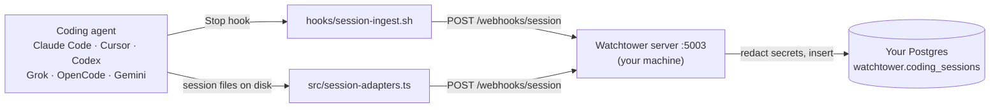

# Watchtower

**Watchtower records what your coding agents tried, which of those
attempts failed, and the error that came back, so the next session
does not repeat the same approach.**

Every agent session ends the same way: the context window closes and
the work disappears with it. Tomorrow's session, or a different agent
in a different tool, retries yesterday's dead end. Watchtower catches
each session as it stops and writes it to a Postgres database you own,
one row per session, across every tool your team uses.

[](./LICENSE)


| | |
|---|---|
| **Captures** | Claude Code, Cursor, Codex, Grok CLI, OpenCode, Gemini CLI, and anything that can POST JSON |
| **Stores** | One row per session in `watchtower.coding_sessions`, in **your** Postgres |
| **Calls a model?** | No. Capture does not call a model and does not care which model wrote the turns |
| **Runs on** | Your laptop (`docker compose up`) or any host you control |
| **Strips** | 17 kinds of secret (API keys, tokens, JWTs, DSNs) before a row is written |
| **License** | Apache-2.0. Version 7.3.0 |



## Contents

- [Quickstart: one row in five minutes](#quickstart-one-row-in-five-minutes)
- [Wire your agents](#wire-your-agents)
- [Handing this to an AI agent](#handing-this-to-an-ai-agent)
- [This is code. It is not our machines.](#this-is-code-it-is-not-our-machines)
- [The pieces, in plain words](#the-pieces-in-plain-words)
- [Running beyond localhost](#running-beyond-localhost)
- [Reference](#reference)
- [Troubleshooting](#troubleshooting)
- [What Braintied runs on top of this](#what-braintied-runs-on-top-of-this)

## Quickstart: one row in five minutes

You need [Docker](https://docs.docker.com/get-started/get-docker/),
[Git](https://git-scm.com/downloads), and `curl`. Nothing else, and no
account anywhere.

**1. Start the stack.** Postgres, PostgREST, a local job runner, and the
Watchtower server come up together on your machine.

```bash
git clone https://github.com/braintied/watchtower.git
cd watchtower
docker compose up --build -d
```

**2. Check the server answers.**

```bash
curl -sS http://localhost:5003/health
# {"status":"ok","service":"watchtower"}
```

**3. Send it a session.** This is the same POST a hook or adapter makes.

```bash
curl -sS -X POST http://localhost:5003/webhooks/session \
  -H 'Content-Type: application/json' \
  -d '{
    "session_key": "claude:quickstart-0001",
    "source": "claude_code",
    "project_slug": "my-repo",
    "messages": [
      {"role": "user", "content": "Fix the flaky login test", "timestamp": "2026-01-01T10:00:00Z"},
      {"role": "assistant", "content": "Retrying with a longer timeout failed: TimeoutError at auth.spec.ts:42", "timestamp": "2026-01-01T10:04:00Z"}
    ]
  }'
# {"status":"ok","session_id":"<uuid>"}
```

**4. See the row in your database.**

```bash
docker compose exec db psql -U postgres -c \
  "SELECT session_key, source, message_count, duration_minutes, created_at
     FROM watchtower.coding_sessions ORDER BY created_at DESC LIMIT 5;"
```

A row with `claude:quickstart-0001`, 2 messages and 4 minutes means
capture works. Now [wire a real agent](#wire-your-agents) so rows
arrive without you.

Stop the stack with `docker compose down`. Your data survives in the
`watchtower-db` volume; `docker compose down -v` deletes it.

## Wire your agents

Two ways a session gets in. Use whichever the tool supports.

| Tool | How Watchtower sees it | Needs a model API key? |
|------|------------------------|------------------------|
| Claude Code | Stop hook (`hooks/session-ingest.sh`) | No |
| Codex | `~/.codex/sessions/**/rollout-*.jsonl` | No |
| Cursor | `~/.cursor/projects/` | No |
| Grok CLI | `~/.grok/sessions/` | No |
| OpenCode | `~/.local/share/opencode/opencode.db` | No |
| Gemini CLI | POST with `"source": "gemini"` | No |
| Anything else | POST a `SessionPayload` (`src/types.ts`) | No |

### A hook: Claude Code

[Claude Code hooks](https://code.claude.com/docs/en/hooks) run a shell
script when a session stops. The installer copies the Watchtower hooks
into place and registers them. It needs Node 20+ and
[`jq`](https://jqlang.github.io/jq/download/); without `jq` the hook
cannot read the transcript and posts an empty session.

```bash
npm install
npm run install-hooks                 # add --dry-run to preview
source ~/.zshrc                       # or ~/.bashrc
```

The installer:

1. Copies `hooks/session-ingest.sh` and `hooks/session-track.sh` to
   `~/.claude/hooks/` (mode 0755).
2. Registers Stop and SessionStart in `~/.claude/settings.json`.
3. Appends `WATCHTOWER_SESSION_WEBHOOK_URL` and
   `WATCHTOWER_SESSION_START_URL` to `~/.zshrc`, `~/.bashrc`, or
   `~/.profile` if they are not already set.

Pass `--url https://your-host/webhooks/session` to point at a server
that is not on localhost. `npm run uninstall-hooks` reverses all three
steps.

The hook never blocks your agent. It POSTs in the background with a
5-second connect timeout, prints `{"continue": true}`, and exits 0
whether or not the server answered.

The Grok CLI also runs every hook in `~/.claude/settings.json` unless
`[compat.claude] hooks = false` is set in `~/.grok/config.toml`.
`hooks/grok/session-event.json` is a PostToolUse fragment for that
case only. Installed beside settings.json, it runs `session-event.sh`
twice per tool call.

### A disk adapter: Codex, Cursor, Grok, OpenCode

These tools already write every session to disk.
`src/session-adapters.ts` knows each layout and exposes three
functions:

| Function | What it does |
|----------|--------------|
| `detect()` | Is this tool installed here? |
| `discover()` | List session files. `stat` only, never reads content |
| `parse(file)` | Return a `SessionPayload` ready to POST |

Codex rollouts can run to several gigabytes, so `parse` streams them
rather than reading the whole file. Walk `discover()`, `parse` each
file, and POST the result to `/webhooks/session`.

A new tool is a new adapter plus a value on `CODING_SESSION_SOURCES`
in `src/types.ts`. Pull requests welcome.

## Handing this to an AI agent

[AGENTS.md](./AGENTS.md) is a step-by-step skill an agent can follow
to stand Watchtower up for you, including the terms it must explain
and the checks that mean done. Paste this into any coding agent:

```text
Read AGENTS.md in https://github.com/braintied/watchtower and set up
Watchtower capture on this machine. Use docker compose. Done is a new
row in watchtower.coding_sessions after I stop a session. Never point
any URL at ora-watchtower.fly.dev.
```

The contract an agent should hold itself to:

- **Done** is a row in `watchtower.coding_sessions`, not a clean
  clone or a green `/health`.
- Every URL and credential belongs to the person being set up.
- Capture needs no model key. Leave `ANTHROPIC_API_KEY` and
  `VOYAGE_API_KEY` empty unless they ask for the optional analyzer.
- `hooks/lib/refuse-hosted.sh` is a guard, not an obstacle. Never add
  a bypass.

## This is code. It is not our machines.

Watchtower is software you run. Cloning it does not connect you to
Braintied, and nothing you capture reaches us.

```
your agent  -->  hook or adapter on your machine  -->  YOUR server :5003  -->  YOUR Postgres
```

- The default webhook is `http://localhost:5003/webhooks/session`, the
  process you started.
- If `WATCHTOWER_SESSION_WEBHOOK_URL` names Braintied's own indexer
  (`ora-watchtower.fly.dev` or `ora-watchtower.internal`),
  `hooks/lib/refuse-hosted.sh` skips the POST and prints why. Your
  transcript does not leave your machine by mistake.
- `SUPABASE_URL` / `SUPABASE_SERVICE_KEY` must name a database you
  created, or the local compose stack. The key in
  `docker-compose.yml` is a local stub that works against that stack
  and nowhere else.
- Before insert, the server strips 17 kinds of secret from the
  session: Anthropic, OpenAI, AWS, GitHub, Stripe, Supabase, Voyage,
  Fly, and Sentry credentials, bearer tokens, JWTs, and long hex
  secrets (`src/lib/redact.ts`).
- Only `user` and `assistant` turns are forwarded. Reasoning traces
  and tool output are dropped; tool names are kept.

[braintied.com/watchtower](https://www.braintied.com/watchtower) is a
public feed of Braintied's own sessions. It is not an inbox for yours.

## The pieces, in plain words

No account is needed for any of these on localhost. Compose runs them
all.

| Piece | What it does here |
|-------|-------------------|
| [PostgreSQL](https://www.postgresql.org/) | The database. Rows live in schema `watchtower`, created by `migrations/001_init.sql` |
| [pgvector](https://github.com/pgvector/pgvector) | Postgres extension for embedding vectors. Only the optional analyzer uses it. The compose image includes it |
| [PostgREST](https://docs.postgrest.org/en/latest/) | Turns the `watchtower` tables into an HTTP API, which is how the server writes rows. `http://127.0.0.1:54321` from your laptop, `http://rest:3000` inside compose |
| `WATCHTOWER_REST_URL` | A bare PostgREST, such as the compose one or your own in front of Postgres 15. No supabase.com account required |
| `SUPABASE_URL`, `SUPABASE_SERVICE_KEY` | Names that follow the `@supabase/supabase-js` convention. `SUPABASE_URL` is a [Supabase project you created](https://supabase.com/docs/guides/getting-started); the server writes to its `/rest/v1`. The key is whatever your PostgREST accepts, under either URL |
| [Inngest](https://www.inngest.com/docs) | A background-job runner. The server hands "analyze this later" to it so the webhook returns in milliseconds. Compose runs it locally; its UI is `http://127.0.0.1:8288` |
| [Hono](https://hono.dev/) | The small Node HTTP framework in `src/index.ts`. You do not need to know it |
| [Docker Compose](https://docs.docker.com/compose/) | Starts all of the above with one command |

### Without Docker

Install Postgres 15, apply `migrations/001_init.sql`, run PostgREST
against it, then:

```bash
export WATCHTOWER_REST_URL=http://127.0.0.1:3000   # your PostgREST
export SUPABASE_SERVICE_KEY=<a JWT your PostgREST accepts>
npm install
npm run build && npm start                          # or: npm run dev
```

For a Supabase project, set `SUPABASE_URL` to the project URL
instead of `WATCHTOWER_REST_URL`. The server refuses to start without
one of the two URLs and the key (`src/lib/db.ts`). The PostgREST role
your key names needs write access to the `watchtower` tables;
`docker/initdb/000_local_roles.sql` shows the grants compose uses.

### The optional analyzer

`src/inngest/session-analyzer.ts` can summarise and embed each session.
It currently calls Anthropic and Voyage, and stays idle while
`ANTHROPIC_API_KEY` and `VOYAGE_API_KEY` are empty. Capture never
depends on it. Swap the provider if you want a different model.

## Running beyond localhost

Localhost is enough until a second machine needs to send sessions.
Then the webhook needs a URL that machine can reach.

[Fly.io](https://fly.io/docs/launch/deploy/),
[Render](https://render.com/docs/deploys), or any VM that runs Node 20
and reaches your Postgres will do. The `Dockerfile` builds the server
as-is. Set `WATCHTOWER_REST_URL` (or `SUPABASE_URL`) and
`SUPABASE_SERVICE_KEY` for your database,
deploy, and point each machine's hook at it:

```bash
npm run install-hooks -- --url https://watchtower.your-company.dev/webhooks/session
```

Name your app anything except `ora-watchtower`. That name is
Braintied's, and the hook refuses its host.

## Reference

### Webhook payload

`POST /webhooks/session`, validated by Zod in `src/webhook/session.ts`.
Only `session_key` is required.

| Field | Type | Notes |
|-------|------|-------|
| `session_key` | string | Unique per session. A repeat POST with the same key updates the row, so the latest Stop wins. See [session keys](#session-keys) |
| `source` | enum | One of `CODING_SESSION_SOURCES`: `claude_code`, `cursor`, `codex`, `gemini`, `opencode`, `grok`, `kulti_meet`. Default `claude_code` |
| `project_slug` | string | Which repo. See [which project](#which-project) |
| `messages[]` | `{role, content, timestamp, tool_name?}` | When present, `message_count`, `tools_used`, and `duration_minutes` are derived from it |
| `message_count`, `duration_minutes` | number | Override the derived values |
| `files_touched`, `tools_used` | string[] | |
| `session_started_at`, `session_ended_at` | ISO 8601 | |
| `metadata` | object | Free-form. `metadata.raw_content` holds the transcript, capped at 50,000 characters |

The Claude Code Stop hook sends the short form:

```json
{
  "session_key": "claude:<uuid>",
  "source": "claude_code",
  "project_slug": "your-repo",
  "message_count": 12,
  "metadata": {
    "raw_content": "[user] …\n[assistant] …",
    "source_hook": "oss-session-ingest"
  }
}
```

It reads the transcript from
`~/.claude/projects/<cwd-with-slashes-as-dashes>/<session-id>/subagents/*.jsonl`.

### Server routes

| Method | Path | What |
|--------|------|------|
| GET | `/health` | `{"status":"ok","service":"watchtower"}` |
| POST | `/webhooks/session` | Ingest one session. Returns `{"status":"ok","session_id":"<uuid>"}` |
| POST | `/webhooks/session-start` | Session start tracker |
| GET/POST/PUT | `/api/inngest` | Where the local Inngest finds the analyzer functions |

### Tables

`migrations/001_init.sql` creates two tables in schema `watchtower`:

| Table | Holds |
|-------|-------|
| `coding_sessions` | One row per session: `session_key` (unique), `source`, `message_count`, `duration_minutes`, `files_touched`, `tools_used`, `metadata`, timestamps, and analyzer columns (`title`, `ai_summary`, `embedding`) |
| `session_chunks` | Embedded transcript slices, written only by the optional analyzer |

### Session keys

`hooks/lib/session-key.sh` writes `source:<uuid>`:

```
claude:99918550-4efe-4c62-91aa-…
grok:01a0104f-e804-7a41-bbb7-a4c823c07d03
codex:0f3a…
```

It finds the tool by walking the parent process on every event.
Recognised: `claude`, `codex`, `cursor` / `cursor-agent`, `opencode`,
`grok`, `kimi`, `zai`, `minimax`. `GROK_AGENT` / `GROK_HOME`
short-circuit to `grok`. With no match it writes `claude`, because
Claude Code is the host that loads `~/.claude/settings.json` for other
tools too. The `source` column is `claude_code` for Claude Code and the
tool id otherwise.

`hooks/session-track.sh` still builds an older
`encoded-cwd/session-id` key. `session-key.sh` is the contract.

### Which project

`hooks/lib/project-slug.sh` (TypeScript: `src/project-slug.ts`)
resolves the repo name in three rungs:

1. The basename of the `origin` remote.
2. The parent of `--git-common-dir`, so a linked worktree resolves to
   its main checkout, not the worktree folder.
3. `basename(cwd)`, only when the directory is not a repo.

`GIT_DIR`, `GIT_WORK_TREE`, `GIT_CEILING_DIRECTORIES`, and the rest of
the list in `src/project-slug.ts` are scrubbed first. Results cache in
`~/.cache/watchtower/project-slug/` for `WATCHTOWER_SLUG_TTL_MIN`
minutes. If a `watchtower resolve-project` binary is on `PATH`, the
script asks it first. An omitted `cwd_is_repo` means unknown; never
default it to `false`.

### Environment

There is no `.env` in the repo. Compose sets everything the stack
needs. Outside compose, put these in `.env.local`:

| Variable | Default | Needed for |
|----------|---------|------------|
| `WATCHTOWER_REST_URL` | none | The server, with a bare PostgREST. Wins over `SUPABASE_URL` |
| `SUPABASE_URL` | none | The server, with a Supabase project (writes to `/rest/v1`) |
| `SUPABASE_SERVICE_KEY` | none | The server. A key your PostgREST accepts |
| `WATCHTOWER_SESSION_WEBHOOK_URL` | `http://localhost:5003/webhooks/session` | Hooks |
| `WATCHTOWER_SESSION_START_URL` | `http://localhost:5003/webhooks/session-start` | Hooks |
| `WATCHTOWER_SOURCE_COLUMN` | from `session-key.sh` | Hooks, to force a `source` |
| `WATCHTOWER_SLUG_CACHE_DIR` | `~/.cache/watchtower/project-slug` | Project resolver |
| `WATCHTOWER_SLUG_TTL_MIN` | `1440` | Project resolver |
| `PORT` | `5003` | The server |
| `ANTHROPIC_API_KEY` | empty | Optional analyzer only |
| `VOYAGE_API_KEY` | empty | Optional analyzer embeddings only |

### Ports under compose

| Port | Service |
|------|---------|
| 5003 | Watchtower server |
| 54321 | PostgREST |
| 54322 | Postgres 15 + pgvector (volume `watchtower-db`) |
| 8288 | Local Inngest UI |

### Files

| Path | What it is |
|------|------------|
| `src/index.ts` | Hono server on `:5003` |
| `src/webhook/session.ts` | Ingest: validate, derive, redact, upsert by `session_key` |
| `src/session-adapters.ts` | `detect` / `discover` / `parse` for Codex, Cursor, OpenCode, Grok |
| `src/project-slug.ts` | Three-rung project resolver and `GIT_*` scrub |
| `src/types.ts` | `CODING_SESSION_SOURCES`, `SessionPayload`, default URL |
| `src/lib/redact.ts` | Secret stripping before insert |
| `src/lib/db.ts` | PostgREST client; refuses to start without a URL and key |
| `src/inngest/` | Optional analyzer and scanner |
| `hooks/session-ingest.sh` | Claude Code Stop hook |
| `hooks/session-track.sh` | Claude Code SessionStart hook |
| `hooks/lib/session-key.sh` | `source:<uuid>` from the process tree |
| `hooks/lib/project-slug.sh` | Shell half of the project resolver |
| `hooks/lib/refuse-hosted.sh` | Refuses Braintied's hosted indexer |
| `hooks/grok/session-event.json` | Grok CLI PostToolUse fragment |
| `scripts/install-hooks.ts` | Installs hooks and patches `settings.json` |
| `migrations/001_init.sql` | Schema, tables, and search function |
| `docker/initdb/000_local_roles.sql` | PostgREST roles and grants for the compose database only |
| `docker-compose.yml` | Local Postgres, PostgREST, Inngest, server |

## Troubleshooting

| Symptom | Cause and fix |
|---------|---------------|
| `curl: (7) Failed to connect` on `/health` | The server is not running. `docker compose ps`, then `docker compose logs watchtower` |
| Stopped a Claude Code session, no new row | Check `jq` is installed, the Stop hook is in `~/.claude/settings.json`, and `echo $WATCHTOWER_SESSION_WEBHOOK_URL` is your server |
| `watchtower: refusing to POST to Braintied production` | Your webhook URL names Braintied's indexer. Point it at your own server |
| `{"error":"Validation failed"}` | The payload broke the schema. `issues` in the response names the field; `source` must be a value in `CODING_SESSION_SOURCES` |
| `{"error":"Failed to store session"}` | Read `detail`. A permission error means the PostgREST role lacks grants on `watchtower` tables |
| Tables missing after `compose up` | The volume existed before the migration ran. `docker compose down -v`, then up again (this deletes stored rows) |
| Server exits at start with a credentials error | No REST URL or no `SUPABASE_SERVICE_KEY`. Compose sets both; outside compose, export them |

## What Braintied runs on top of this

[Braintied](https://www.braintied.com) built Watchtower for its own
agents. This repository is the capture half, published under
Apache-2.0. The rest of what we run on these rows (a live floor of
every running session, an operator board of what needs a human,
recall across past sessions, error fingerprints, a hosted indexer)
stays private. You can build those on the rows this client writes.

| Name | What it is |
|------|------------|
| [braintied/watchtower](https://github.com/braintied/watchtower) | This repository |
| `@braintied/watchtower-capture` | This code on [GitHub Packages](https://github.com/orgs/braintied/packages/npm/package/watchtower-capture) |
| `@braintied/watchtower` | Braintied's private fleet package. Installing it does not give you our indexer |
| `ora-watchtower.fly.dev` | Braintied's hosted indexer. The hook refuses it |
| [Releases](https://github.com/braintied/watchtower/releases) | Tagged snapshots of this tree |

To install the capture code as a package (no server):

```bash
npm install @braintied/watchtower-capture --registry=https://npm.pkg.github.com
```

GitHub Packages needs a token with `read:packages`
([how](https://docs.github.com/en/packages/working-with-a-github-packages-registry/working-with-the-npm-registry)).

Want Watchtower stood up for your team, on your host and your
database? That is [consulting](https://www.braintied.com/consulting).
Email [hello@braintied.com](mailto:hello@braintied.com).

## License

Apache-2.0. Agents setting this up: [AGENTS.md](./AGENTS.md). Humans
sending a patch: [CONTRIBUTING.md](./CONTRIBUTING.md).
